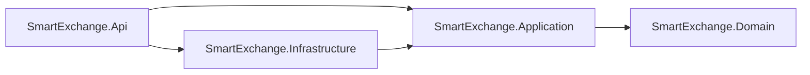
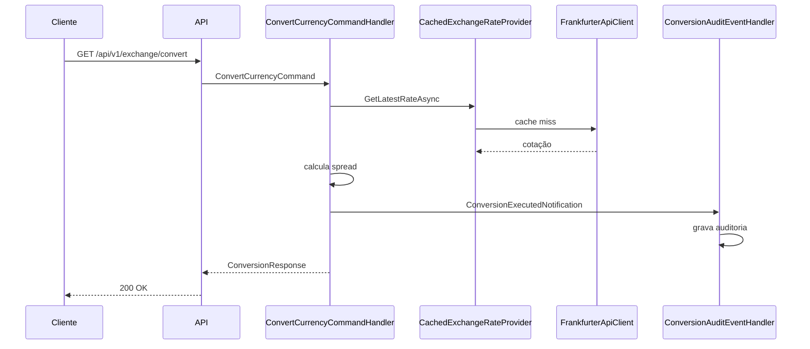

# SmartExchange Gateway

Gateway de câmbio em .NET 9 que converte valores entre moedas com spread dinâmico por perfil de cliente, consulta cotações e histórico, valora carteiras multimoeda e registra uma auditoria imutável de cada conversão.

## Funcionalidades

- **Conversão com spread** por perfil (`Standard` 3,5%, `Premium` 1,5%, `Vip` 0,5%).
- **Valoração de carteira** com total consolidado e fatia percentual de cada ativo, com soma exata de 100,00%.
- **Cotações** em tempo real, histórico (7, 30 ou 90 dias) e dicionário de moedas.
- **Auditoria** de cada conversão, persistida em PostgreSQL e consultável por API.
- **Cache** no Redis com TTLs por volatilidade dos dados.
- **Erros padronizados** em RFC 7807 (Problem Details).

## Arquitetura

Clean Architecture, com dependências sempre apontando para o domínio:



| Projeto | Responsabilidade |
|---|---|
| `Domain` | Value objects (`Currency`, `Money`), cotação, spread, cálculo de fatias. Sem dependências externas. |
| `Application` | Casos de uso CQRS com MediatR, contratos (`IExchangeRateProvider`, `IConversionAuditRepository`) e notificações. |
| `Infrastructure` | Cliente HTTP da Frankfurter, resiliência, cache Redis, EF Core com PostgreSQL. |
| `Api` | Endpoints HTTP, tratamento global de erros, composição de DI e documentação (Scalar). |

Fluxo de uma conversão:



## Endpoints

| Método | Rota | Descrição |
|---|---|---|
| GET | `/api/v1/exchange/convert?from&to&amount&tier` | Converte um valor com o spread do perfil |
| POST | `/api/v1/exchange/portfolio/valuate` | Valora uma carteira e devolve a fatia de cada ativo |
| GET | `/api/v1/exchange/history?base&target&period` | Série temporal (`7d`, `30d` ou `90d`) |
| GET | `/api/v1/exchange/latest?base` | Cotações da moeda base |
| GET | `/api/v1/exchange/currencies` | Moedas suportadas com nomes |
| GET | `/api/v1/exchange/audit?take` | Últimas conversões auditadas (máximo 100) |

Exemplo de erro:

```json
{
  "type": "https://tools.ietf.org/html/rfc9110#section-15.5.1",
  "title": "Requisição inválida",
  "status": 400,
  "detail": "Código de moeda inválido: 'US'. Use 3 letras ISO 4217.",
  "traceId": "00-..."
}
```

## Como executar

### Com Docker (recomendado)

Pré-requisito: Docker em execução.

```bash
docker compose up --build -d
```

Serviços:

| Serviço | Endereço no host |
|---|---|
| API | `http://localhost:5000` |
| Documentação (Scalar) | `http://localhost:5000/scalar/v1` |
| PostgreSQL | `localhost:5434` (usuário e banco `smartexchange`) |
| Redis | `localhost:6379` |

A API só inicia depois que PostgreSQL e Redis estão `healthy`.

**Atenção:** a API não cria o schema do banco. Em um ambiente novo, aplique a migration antes de usar a auditoria:

```bash
dotnet ef database update --project src/SmartExchange.Infrastructure --startup-project src/SmartExchange.Api --context AuditDbContext
```

Ver [ADR-023](docs/adr/fase-06-docker-testcontainers/ADR-023-migrations-no-startup-da-api.md) (status: proposto).

### Localmente, sem Docker

Requer o SDK 9.0.318 ou superior, PostgreSQL e Redis acessíveis. Ajuste as connection strings em `src/SmartExchange.Api/appsettings.json` (`ConnectionStrings:AuditDb` e `ConnectionStrings:Redis`).

```bash
dotnet run --project src/SmartExchange.Api
```

## Testes

```bash
dotnet build SmartExchange.sln
dotnet test SmartExchange.sln
```

| Suíte | Projeto | Escopo | Dependências |
|---|---|---|---|
| Unitária | `tests/SmartExchange.Tests.Unit` | Domínio, handlers, cliente HTTP (com `HttpMessageHandler` mockado), decorator de cache, mapeamento do EF | Nenhuma |
| Integração | `tests/SmartExchange.Tests.Integration` | Fluxo ponta a ponta com PostgreSQL e Redis reais | Docker em execução |

A suíte de integração sobe os contêineres por conta própria, com portas dinâmicas, e os remove ao final. A Frankfurter é substituída por um fake determinístico (ver ADR-022).

Resultado da última validação: 113 testes unitários e 5 de integração, todos aprovados, com build sem avisos.

## Configuração

Principais chaves em `appsettings.json` (e variáveis de ambiente com `__`):

| Chave | Padrão | Uso |
|---|---|---|
| `ConnectionStrings:AuditDb` | Postgres local na porta 5434 | Auditoria |
| `ConnectionStrings:Redis` | `localhost:6379` | Cache |
| `Frankfurter:BaseUrl` | `https://api.frankfurter.app` | Provedor de cotações (ver ADR-011) |

## Integração contínua

`.github/workflows/ci.yml` roda restore, build e testes em `push` e `pull_request` para `main` e `feature/**`, com o SDK definido em `global.json`.

## Documentação técnica

As decisões de arquitetura estão em [`docs/adr`](docs/adr/README.md), organizadas por fase:

| Fase | Conteúdo |
|---|---|
| [01 - Setup](docs/adr/fase-01-setup/README.md) | Solution, SDK fixado, Clean Architecture, versionamento |
| [02 - Domínio](docs/adr/fase-02-domain-logic/README.md) | Value objects, arredondamento, estratégias de spread |
| [03 - Infraestrutura HTTP e CI](docs/adr/fase-03-infrastructure-http-ci/README.md) | Cliente Frankfurter, resiliência, pipeline |
| [04 - Cache e Auditoria](docs/adr/fase-04-cache-redis-audit-db/README.md) | Decorator de cache, EF Core, porta do banco |
| [05 - Aplicação e API](docs/adr/fase-05-application-cqrs-api/README.md) | CQRS, notificações, fatias, RFC 7807 |
| [06 - Docker e Testes](docs/adr/fase-06-docker-testcontainers/README.md) | Dockerfile, compose, Testcontainers |

Especificações de cada fase, com checklist de implementação, estão em [`specs/`](specs/).

## Pontos em aberto

- Aplicação automática de migrations no startup ([ADR-023](docs/adr/fase-06-docker-testcontainers/ADR-023-migrations-no-startup-da-api.md), proposto).
- Histórico de commits: os binários de `bin/` e `obj/` da primeira versão ainda estão no histórico (ver [ADR-003](docs/adr/fase-01-setup/ADR-003-build-output-fora-do-versionamento.md)).
- Uso do host legado `api.frankfurter.app` ([ADR-011](docs/adr/fase-03-infrastructure-http-ci/ADR-011-host-legado-da-frankfurter-api.md)).
- Credenciais de desenvolvimento em texto claro no compose e no `appsettings.json` ([ADR-024](docs/adr/fase-06-docker-testcontainers/ADR-024-alinhamento-de-credenciais-e-connection-strings.md)).
